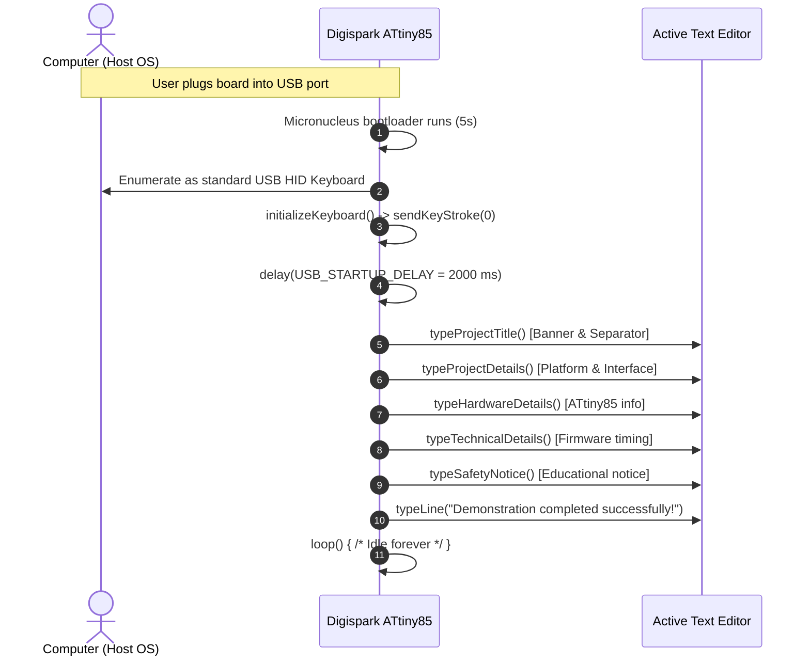

# ATtiny85 USB HID Keyboard Emulation Demo (Rubber Ducky)

[](http://digistump.com/)
[](https://www.usb.org/hid)
[-brightgreen.svg)](https://github.com/digistump/DigistumpArduino)
[](LICENSE)

> [!WARNING]
> **DISCLAIMER: FOR EDUCATIONAL USE AND AUTHORIZED TESTING ONLY**
> This repository contains firmware intended strictly for educational study, hardware security awareness, and authorized testing in controlled environments.
>
> **Harmless Demo Guarantee**: The firmware contained herein executes **no system shell commands**, accesses **no local or network files**, collects **no user data**, and modifies **no system settings**. It strictly behaves as a standard Human Interface Device (HID) keyboard to output a benign informational banner into whichever text editor is actively in focus.

---

## Overview

Modern operating systems implicitly trust Human Interface Devices such as USB keyboards: once connected, keystrokes are accepted immediately without requiring administrator consent or third-party drivers. Keystroke injection devices (commonly termed "Rubber Duckies") demonstrate the security implications of this unauthenticated trust model.

This project implements an educational demonstration on the low-cost **Digispark ATtiny85** microcontroller board. Using the bit-banged **V-USB** software USB stack via the Arduino `DigiKeyboard` library, the ATtiny85 enumerates as a standard USB keyboard and automatically types out a demonstration summary once upon connection.

---

## Features

- **Standard HID Enumeration**: Emulates a standard USB keyboard using software-driven USB (V-USB) on an 8-bit AVR architecture.
- **Single-Shot Execution**: Runs the typing routine once inside `setup()` and enters an infinite idle loop in `loop()` to avoid repeated or runaway typing.
- **Configurable Pacing**: Employs well-defined timing intervals (`USB_STARTUP_DELAY`, `LINE_DELAY`, `TYPING_DELAY`) for reliable USB host enumeration across operating systems.
- **Safe Demonstration Message**: Types an educational overview of the hardware and firmware parameters with a clear security notice.

---

## Hardware Configuration

| Component | Specification | Description |
|---|---|---|
| Microcontroller | Microchip ATtiny85 (8-bit AVR RISC) | 8 KB Flash, 512 B SRAM, 512 B EEPROM |
| Development Board | Digispark Rev 3 (or compatible clone) | Integrated on-board USB-A PCB trace connector |
| Clock Speed | 16.5 MHz (internal PLL) | High-speed clock required for software USB bit-banging |
| I/O Pins Used | PB3 (USB D+), PB4 (USB D-) | Dedicated to low-speed software USB signaling |
| Status LED | Built-in LED on Model A (PB1) or Model B (PB0) | Activity indication |

---

## Firmware Configuration Constants

| Constant | Value | Purpose |
|---|---|---|
| `USB_STARTUP_DELAY` | `2000 ms` | Warm-up window giving the host OS time to enumerate the USB device before key transmission starts |
| `LINE_DELAY` | `700 ms` | Delay following each Enter keypress (`0x28`) allowing the host text editor to handle carriage return |
| `TYPING_DELAY` | `100 ms` | Short delay between typing the string and carriage return to avoid host USB buffer overrun |

---

## Demonstration Sequence Flow



---

## Setup & Flashing Guide

### 1. Arduino IDE Board Package Installation
1. Install [Arduino IDE](https://www.arduino.cc/en/software) (1.8.x legacy or 2.x).
2. Go to **File > Preferences** (or **Arduino IDE > Settings**).
3. In **Additional Boards Manager URLs**, paste:
   ```
   http://digistump.com/package_digistump_index.json
   ```
4. Open **Tools > Board > Boards Manager...**, search for `Digistump AVR Boards`, and click **Install**.

### 2. Driver Setup (Windows only)
- If the board is unrecognized or fails during upload, install the [Digistump USB Drivers](https://github.com/digistump/DigistumpArduino/releases) (run `DPinst64.exe` or `Install Drivers.exe`).

### 3. Upload Procedure
The Digispark uses the Micronucleus bootloader, which requires a specific upload sequence:
1. Open `firmware/usb_rubber_ducky/usb_rubber_ducky.ino` in Arduino IDE.
2. In **Tools > Board**, select **Digispark (Default - 16.5mhz)**.
3. In **Tools > Programmer**, leave as default (Micronucleus).
4. **DO NOT plug the Digispark in yet.**
5. Click the **Upload** button.
6. Observe the console output. When the prompt appears:
   ```text
   Running Digispark Uploader...
   Plug in device now... (will timeout in 60 seconds)
   ```
7. Now plug the Digispark board into the computer's USB port.
8. The uploader will detect the device, flash the firmware, and confirm:
   ```text
   Micronucleus done. Thank you!
   ```

---

## Defensive Countermeasures

Physical keystroke injection can be mitigated through layered enterprise and endpoint security practices:

1. **USB Device Allow-Listing**: Implement Group Policy Objects (GPO) or Endpoint Detection and Response (EDR) agents to restrict USB device insertion based on specific Vendor ID (VID) / Product ID (PID) or serial numbers.
2. **Disabling Unknown HID Additions**: Enforce policies that require administrative approval or secondary user authentication before registering new HID keyboard interfaces on locked or corporate systems.
3. **Endpoint Security Policies**: Restrict unauthorized interactive shells, script execution policies (e.g. PowerShell `Restricted` / `AllSigned`), and enable software restriction policies (AppLocker / Windows Defender Application Control).
4. **Physical Security & Awareness**: Educate personnel never to insert untrusted USB thumb drives or unknown peripherals found in public or semi-private workspaces.

---

## Challenges & What I Learned

- **V-USB Timing Sensitivity**: Software USB bit-banging on an ATtiny85 requires precise oscillator calibration. The internal PLL must run at 16.5 MHz so that USB 1.1 low-speed (1.5 Mbps) timing tolerances are strictly met.
- **Enumeration Delays Across Host Operating Systems**: Different host operating systems take between 1.5 and 3 seconds to complete USB enumeration and driver binding. Introducing an explicit startup delay (`USB_STARTUP_DELAY`) prevents dropping early characters.
- **Typing Buffer Management**: Pacing strings with moderate line delays ensures the host operating system's input event queue does not drop characters during fast burst writes.

---

## Future Improvements

- [ ] **Caps-Lock / Num-Lock Host Synchronization**: Read keyboard LED return reports from the host via USB OUT endpoints to detect host read-state before emitting characters.
- [ ] **Multi-Layout Keycode Translation**: Add support for non-US keyboard layouts (e.g., UK, AZERTY, QWERTZ) by mapping scan codes dynamically.
- [ ] **Hardware Status Indication**: Blink the onboard LED while waiting for enumeration and turn it solid upon successful payload completion.

---

## License & Contact

Distributed under the **MIT License**. See [LICENSE](LICENSE) for details.

- **Author**: Rudra Patel
- **Institution**: Pandit Deendayal Energy University (PDEU), B.Tech ICT
- **Target Role**: Embedded Software / Firmware Engineer
- **LinkedIn**: [linkedin.com/in/rudra-patel0314](https://www.linkedin.com/in/rudra-patel0314/)
- **Email**: [rudrapatel0314@gmail.com](mailto:rudrapatel0314@gmail.com)
